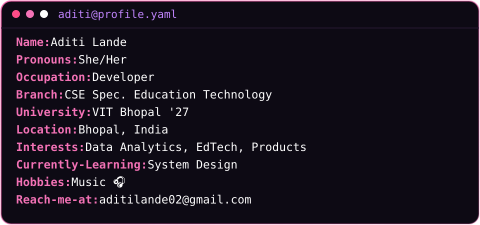

<!-- Top Animated Line -->

<!-- Typing SVG Header -->

<h3 align="center">Developer | Building Products | Data & EdTech ⚡</h3>

 

<!-- Side-by-Side: Right Neon Graphic Floated First + Left Card SVG Flush -->

 

 

<!-- Dark & Light Mode Animated Terminal Header -->
<picture>
  <source media="(prefers-color-scheme: dark)" srcset="./dark.svg?v=1">
  <source media="(prefers-color-scheme: light)" srcset="./light.svg?v=1">
  
</picture>

 

<!-- Connect With Me -->
<h2 align="left">🧑🏻‍💻 &nbsp; Connect with me</h2> 

  
  &nbsp;
  
  &nbsp;
  

 

<!-- Tech Stack -->
<h2 align="left">🛠 &nbsp; Tech Stack</h2>

  

 

