<!-- Top Animated Line -->


<div align="center">

<!-- Typing SVG Header -->
<a href="https://git.io/typing-svg">
  
</a>

<h3 align="center">Building Resilient, High-Throughput Distributed Web Systems ⚡</h3>

<!-- Profile Visits & Status Badges -->
<p align="center">
  
  
  
  
</p>

</div>

<br/>

<!-- Side-by-Side: Right-Aligned Hacker GIF & Aditi's YAML Card -->


```yaml
Name: Aditi Lande
Pronouns: She/Her
Occupation: Developer
Branch: Computer Science Engineering Spec. Education Technology
University: Vellore Institute of Technology, Bhopal
Location: Bhopal, India
Interests: Data Analytics, EdTech, Building Products
Currently-Learning: System Design
Hobbies: Music 🎧
Reach-me-at: aditilande08@gmail.com
```

<br/>

<!-- Animated Interactive Terminal Header with Real Portrait Morphing -->
<picture>
  <source media="(prefers-color-scheme: dark)" srcset="./header.svg">
  <source media="(prefers-color-scheme: light)" srcset="./header.svg">
  
</picture>

<br/>

<h2 align="left">🧑🏻‍💻 &nbsp; Connect with me</h2> 

<p align="left">
  <a href="https://linkedin.com/in/aditi-lande" target="_blank">
    
  </a>
  &nbsp;
  <a href="https://github.com/aditilande08" target="_blank">
    
  </a>
  &nbsp;
  <a href="https://leetcode.com/u/aditilande08/" target="_blank">
    
  </a>
  &nbsp;
  <a href="mailto:aditilande08@gmail.com" target="_blank">
    
  </a>
</p>

<br/>

<h2 align="left">📚 &nbsp; Languages and Tools</h2>

<p align="left">
  <a href="https://go-skill-icons.vercel.app/">
    
  </a>
</p>

<br/>

<h2>🚀 &nbsp; Core Production Systems (Audited &amp; Defended)</h2>

<table>
  <thead>
    <tr>
      <th width="35%">System</th>
      <th width="45%">Engineering Architecture</th>
      <th width="20%">Access</th>
    </tr>
  </thead>
  <tbody>
    <tr>
      <td>
        <b>Healthcare Appointment Platform</b><br/>
        <sub>Node.js • Express • PostgreSQL • Docker • Jest</sub>
      </td>
      <td>
        • <b>Transactional Advisory Locks (<code>pg_advisory_xact_lock</code>)</b> preventing appointment race conditions and double-booking during concurrent spikes.<br/>
        • 9 automated Jest test suites verifying lock releases, transaction retries, and API contracts.<br/>
        • Docker Compose orchestration for unified database and service startup.
      </td>
      <td>
        <a href="https://healthcare-app-three-theta.vercel.app"><b>🌐 Live Demo</b></a><br/>
        <a href="https://github.com/aditilande08/healthcare-appointment-platform"><b>📦 Repository</b></a>
      </td>
    </tr>
    <tr>
      <td>
        <b>DevLens AI</b><br/>
        <sub>19-Page Academic Capstone Paper • Node.js • SQLite • Chart.js</sub>
      </td>
      <td>
        • <b>Heuristic Static Analysis &amp; Jaccard Similarity</b> stack matcher evaluating student repositories against industry engineering baselines.<br/>
        • Algorithmic Portfolio Quality Score (PQS) engine factoring commit rhythm, cyclomatic complexity, and documentation completeness.<br/>
        • Interactive radar competency mapping visualizer.
      </td>
      <td>
        <a href="https://github.com/aditilande08/devlens-ai"><b>📦 Repository</b></a>
      </td>
    </tr>
    <tr>
      <td>
        <b>TalentDash</b><br/>
        <sub>Next.js 16 (App Router) • React 19 • PostgreSQL • Prisma • Tailwind</sub>
      </td>
      <td>
        • High-throughput compensation analytics dashboard utilizing React 19 server/client boundaries.<br/>
        • <b>Composite B-tree indexing</b> (<code>@@index([company_id, level, location])</code>) for sub-50ms multi-parameter queries.<br/>
        • Automated normalization pipeline resolving unstandardized company aliases.
      </td>
      <td>
        <a href="https://talentdash-seven.vercel.app"><b>🌐 Live Demo</b></a><br/>
        <a href="https://github.com/aditilande08/talentdash"><b>📦 Repository</b></a>
      </td>
    </tr>
  </tbody>
</table>

<br/>

<h2>📈 &nbsp; LeetCode &amp; GitHub Analytics</h2>

<p align="center">
  <a href="https://leetcode.com/u/aditilande08/" target="_blank">
    
  </a>
</p>

<div align="center">
  
  
</div>

<br/>


